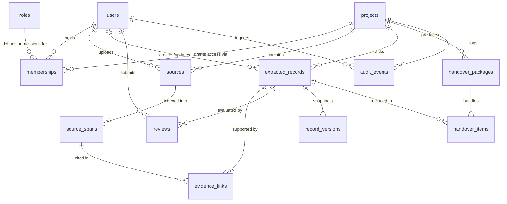

# BATON — Relational Data Model (`DATA_MODEL.md`)

## 1. Entity-Relationship Overview

BATON uses a relational SQLite schema with foreign key enforcement (`PRAGMA foreign_keys = ON`). All 12 core domain entities are modeled as relational tables with explicit ownership, provenance locators, and auditability.

---

## 2. Core Entities, Fields, Relationships & Ownership

### 2.1 `roles`
Defines the canonical system and project roles.
- **Ownership:** System-defined reference table (seeded at startup, immutable via public API).

| Field | Type | Constraints | Description |
| :--- | :--- | :--- | :--- |
| `id` | `TEXT` | `PRIMARY KEY` | Role code: `'PI_LEAD'`, `'RESEARCHER'`, `'REVIEWER'`, `'INCOMING_MEMBER'`, `'AUDITOR'` |
| `name` | `TEXT` | `NOT NULL` | Human-readable role title |
| `description` | `TEXT` | `NOT NULL` | Summary of role responsibilities and boundaries |
| `can_access_restricted` | `INTEGER` | `NOT NULL DEFAULT 0` | `1` only for `PI_LEAD` (controls visibility of `RESTRICTED_PI_ONLY` sources) |

---

### 2.2 `users`
Registered researchers, principal investigators, reviewers, and incoming students.
- **Ownership:** Self/System-managed identity record.

| Field | Type | Constraints | Description |
| :--- | :--- | :--- | :--- |
| `id` | `TEXT` | `PRIMARY KEY` | UUID / deterministic ID (e.g., `usr_pi_01`) |
| `email` | `TEXT` | `NOT NULL UNIQUE` | Institutional email |
| `full_name` | `TEXT` | `NOT NULL` | Display name |
| `department` | `TEXT` | `NOT NULL` | Research group or academic department |
| `api_token` | `TEXT` | `NOT NULL UNIQUE` | Bearer token used by deterministic auth middleware |
| `created_at` | `TEXT` | `NOT NULL` | ISO-8601 UTC timestamp |

---

### 2.3 `projects`
A research continuity workspace for a specific study or lab sub-team.
- **Ownership:** Owned by `owner_user_id` (`users.id`), who holds the `PI_LEAD` membership.

| Field | Type | Constraints | Description |
| :--- | :--- | :--- | :--- |
| `id` | `TEXT` | `PRIMARY KEY` | UUID / deterministic ID (e.g., `prj_solidstate_01`) |
| `slug` | `TEXT` | `NOT NULL UNIQUE` | URL-friendly project code |
| `name` | `TEXT` | `NOT NULL` | Project title |
| `description` | `TEXT` | `NOT NULL` | Research scope and continuity goal |
| `owner_user_id` | `TEXT` | `NOT NULL REFERENCES users(id)` | Project creator / Principal Investigator |
| `status` | `TEXT` | `NOT NULL DEFAULT 'ACTIVE'` | `'ACTIVE'`, `'ARCHIVED'` |
| `created_at` | `TEXT` | `NOT NULL` | ISO-8601 UTC timestamp |

---

### 2.4 `memberships`
Links `users` to `projects` with a specific `role_id`. Enforces project-scoped RBAC.
- **Ownership:** Managed by the project's `PI_LEAD`. Unique on `(project_id, user_id)`.

| Field | Type | Constraints | Description |
| :--- | :--- | :--- | :--- |
| `id` | `TEXT` | `PRIMARY KEY` | Membership ID |
| `project_id` | `TEXT` | `NOT NULL REFERENCES projects(id) ON DELETE CASCADE` | Target project |
| `user_id` | `TEXT` | `NOT NULL REFERENCES users(id) ON DELETE CASCADE` | Member user |
| `role_id` | `TEXT` | `NOT NULL REFERENCES roles(id)` | Assigned role (`PI_LEAD`, `RESEARCHER`, `REVIEWER`, `INCOMING_MEMBER`, `AUDITOR`) |
| `added_by_user_id` | `TEXT` | `NOT NULL REFERENCES users(id)` | User who granted membership |
| `created_at` | `TEXT` | `NOT NULL` | ISO-8601 UTC timestamp |

---

### 2.5 `sources`
Uploaded or ingested research artifacts in Stage 1 (Connect).
- **Ownership:** Scoped to `project_id`; uploaded by `uploaded_by_user_id` (`PI_LEAD` or `RESEARCHER`).

| Field | Type | Constraints | Description |
| :--- | :--- | :--- | :--- |
| `id` | `TEXT` | `PRIMARY KEY` | Source ID (e.g., `src_pdf_01`) |
| `project_id` | `TEXT` | `NOT NULL REFERENCES projects(id) ON DELETE CASCADE` | Owning project |
| `title` | `TEXT` | `NOT NULL` | Display title of the source |
| `file_name` | `TEXT` | `NOT NULL` | Original file name (e.g., `electrolyte_cycling_report.pdf`) |
| `source_type` | `TEXT` | `NOT NULL` | Enum: `'PDF_DOCUMENT'`, `'LAB_NOTE'`, `'CSV_DATASET'`, `'JSON_RECORDS'` |
| `visibility_level` | `TEXT` | `NOT NULL DEFAULT 'PROJECT_SHARED'` | Enum: `'PROJECT_SHARED'`, `'RESTRICTED_PI_ONLY'` |
| `exclude_from_ai` | `INTEGER` | `NOT NULL DEFAULT 0` | `1` if explicitly barred from AI prompting/summarisation; automatically `1` when restricted for shared workflows |
| `content_hash` | `TEXT` | `NOT NULL` | SHA-256 hex digest of raw content for integrity checking |
| `raw_content` | `TEXT` | `NOT NULL` | Stored text/structured payload for deterministic span verification |
| `uploaded_by_user_id` | `TEXT` | `NOT NULL REFERENCES users(id)` | Author/uploader |
| `created_at` | `TEXT` | `NOT NULL` | ISO-8601 UTC timestamp |

---

### 2.6 `source_spans`
Granular, immutable provenance units parsed from a `source` during ingestion. Preserves exact source provenance across PDF pages, Markdown/text note sections & lines, and CSV/JSON rows or records.
- **Ownership:** Child of `sources` (`ON DELETE CASCADE`), inheriting `project_id` and `visibility_level` via join.

| Field | Type | Constraints | Description |
| :--- | :--- | :--- | :--- |
| `id` | `TEXT` | `PRIMARY KEY` | Span ID (e.g., `spn_pdf01_p2_1`) |
| `source_id` | `TEXT` | `NOT NULL REFERENCES sources(id) ON DELETE CASCADE` | Parent source |
| `project_id` | `TEXT` | `NOT NULL REFERENCES projects(id) ON DELETE CASCADE` | Denormalized project reference for fast SQL filtering |
| `span_index` | `INTEGER` | `NOT NULL` | Sequential 1-based index within the source |
| `locator_type` | `TEXT` | `NOT NULL` | Enum: `'PDF_PAGE'`, `'NOTE_SECTION_LINE'`, `'CSV_ROW'`, `'JSON_RECORD'` |
| ` locator_label` | `TEXT` | `NOT NULL` | Human-readable canonical citation (e.g., `"Page 2, Para 1"`, `"Section 'Thermal Stability' (Lines 14–19)"`, `"Row #4 (sample_id=SSE-04)"`) |
| `page_number` | `INTEGER` | `NULL` | Populated for `'PDF_PAGE'` sources (1-based page number) |
| `section_heading` | `TEXT` | `NULL` | Populated for `'NOTE_SECTION_LINE'` sources |
| `line_start` | `INTEGER` | `NULL` | Starting line number (1-based) for `'NOTE_SECTION_LINE'` |
| `line_end` | `INTEGER` | `NULL` | Ending line number (1-based) for `'NOTE_SECTION_LINE'` |
| `row_index` | `INTEGER` | `NULL` | 1-based row/record index for `'CSV_ROW'` or `'JSON_RECORD'` |
| `record_key` | `TEXT` | `NULL` | Primary identifier in the CSV/JSON record (e.g., `"SSE-04"`) |
| `column_names_json` | `TEXT` | `NULL` | JSON array of relevant column/field names for `'CSV_ROW'` / `'JSON_RECORD'` |
| `content_text` | `TEXT` | `NOT NULL` | Exact verbatim text or serialized row content of the span |
| `char_start` | `INTEGER` | `NOT NULL DEFAULT 0` | Character offset start in `sources.raw_content` |
| `char_end` | `INTEGER` | `NOT NULL DEFAULT 0` | Character offset end in `sources.raw_content` |
| `created_at` | `TEXT` | `NOT NULL` | ISO-8601 UTC timestamp |

---

### 2.7 `extracted_records`
Structured research continuity knowledge items proposed in Stage 2 (Reconstruct), verified in Stage 3 (Verify), and reviewed in Stage 4 (Review).
- **Ownership:** Scoped to `project_id`; created/edited by `PI_LEAD` or `RESEARCHER`.
- **Invariant:** `evidence_status` and `approval_status` are strictly independent columns. Updating `approval_status` never mutates `evidence_status`. No numerical truth-probability column exists.

| Field | Type | Constraints | Description |
| :--- | :--- | :--- | :--- |
| `id` | `TEXT` | `PRIMARY KEY` | Record ID (e.g., `rec_01`) |
| `project_id` | `TEXT` | `NOT NULL REFERENCES projects(id) ON DELETE CASCADE` | Owning project |
| `record_type` | `TEXT` | `NOT NULL` | Enum: `'CLAIM'`, `'METHOD'`, `'PROTOCOL'`, `'DATASET_FINDING'`, `'OPEN_QUESTION'`, `'RISK_LIMITATION'` |
| `title` | `TEXT` | `NOT NULL` | Concise summary heading |
| `statement` | `TEXT` | `NOT NULL` | Detailed research statement, protocol step, or finding |
| `rationale` | `TEXT` | `NOT NULL DEFAULT ''` | Why this item matters for continuity/handover |
| `origin_mode` | `TEXT` | `NOT NULL` | Enum: `'AI_PROPOSED'`, `'MANUAL_ENTRY'` |
| `evidence_status` | `TEXT` | `NOT NULL DEFAULT 'UNVERIFIED'` | **Categorical Evidence Status Only:** `'UNVERIFIED'`, `'WEAK'`, `'PARTIAL'`, `'SUPPORTED'`, `'CONTRADICTED'`, `'BROKEN_PROVENANCE'` |
| `verification_notes` | `TEXT` | `NOT NULL DEFAULT ''` | Notes from deterministic check + human verifier in Stage 3 |
| `verified_by_user_id` | `TEXT` | `NULL REFERENCES users(id)` | User who last performed Stage 3 verification |
| `verified_at` | `TEXT` | `NULL` | ISO-8601 timestamp of last verification |
| `approval_status` | `TEXT` | `NOT NULL DEFAULT 'DRAFT'` | **Human Approval Status (Separate from Evidence):** `'DRAFT'`, `'PENDING_REVIEW'`, `'APPROVED'`, `'NEEDS_REVISION'`, `'REJECTED'` |
| `current_version` | `INTEGER` | `NOT NULL DEFAULT 1` | Monotonically increasing version counter matching latest `record_versions` row |
| `created_by_user_id` | `TEXT` | `NOT NULL REFERENCES users(id)` | User who triggered extraction or created record |
| `updated_at` | `TEXT` | `NOT NULL` | ISO-8601 UTC timestamp |
| `created_at` | `TEXT` | `NOT NULL` | ISO-8601 UTC timestamp |

---

### 2.8 `evidence_links`
Join entity linking an `extracted_record` to one or more exact `source_spans`. Validated deterministically.
- **Ownership:** Child of `extracted_records` and `source_spans`.

| Field | Type | Constraints | Description |
| :--- | :--- | :--- | :--- |
| `id` | `TEXT` | `PRIMARY KEY` | Evidence link ID |
| `record_id` | `TEXT` | `NOT NULL REFERENCES extracted_records(id) ON DELETE CASCADE` | Target extracted record |
| `span_id` | `TEXT` | `NOT NULL REFERENCES source_spans(id) ON DELETE CASCADE` | Cited source span |
| `relationship_type` | `TEXT` | `NOT NULL DEFAULT 'SUPPORTS'` | Enum: `'SUPPORTS'`, `'PARTIALLY_SUPPORTS'`, `'CONTRADICTS'`, `'CONTEXT_ONLY'` |
| `verbatim_quote` | `TEXT` | `NOT NULL` | Exact substring from `source_spans.content_text` |
| `quote_verified` | `INTEGER` | `NOT NULL DEFAULT 0` | `1` when deterministic validator confirms `verbatim_quote` is an exact substring of `source_spans.content_text` |
| `created_by_user_id` | `TEXT` | `NOT NULL REFERENCES users(id)` | User/process that linked the evidence |
| `created_at` | `TEXT` | `NOT NULL` | ISO-8601 UTC timestamp |

---

### 2.9 `reviews`
Immutable review decisions recorded during Stage 4 (Review).
- **Ownership:** Created by `PI_LEAD` or `REVIEWER` on a project's `extracted_records`.

| Field | Type | Constraints | Description |
| :--- | :--- | :--- | :--- |
| `id` | `TEXT` | `PRIMARY KEY` | Review ID |
| `project_id` | `TEXT` | `NOT NULL REFERENCES projects(id) ON DELETE CASCADE` | Project reference |
| `record_id` | `TEXT` | `NOT NULL REFERENCES extracted_records(id) ON DELETE CASCADE` | Reviewed record |
| `record_version` | `INTEGER` | `NOT NULL` | Version of the record at the moment of review |
| `reviewer_user_id` | `TEXT` | `NOT NULL REFERENCES users(id)` | Reviewer identity |
| `decision` | `TEXT` | `NOT NULL` | Enum: `'APPROVE'`, `'REQUEST_CHANGES'`, `'FLAG_GAP'`, `'REJECT'` |
| `evidence_status_at_review` | `TEXT` | `NOT NULL` | Snapshot of `extracted_records.evidence_status` when reviewed (proving approval did not alter evidence status) |
| `comments` | `TEXT` | `NOT NULL` | Reviewer rationale, caveats, or required corrections |
| `created_at` | `TEXT` | `NOT NULL` | ISO-8601 UTC timestamp |

---

### 2.10 `record_versions` (Versions)
Append-only version history for every `extracted_record`.
- **Ownership:** System-generated deterministically whenever an `extracted_record` is created, edited, verified, or reviewed.

| Field | Type | Constraints | Description |
| :--- | :--- | :--- | :--- |
| `id` | `TEXT` | `PRIMARY KEY` | Version row ID |
| `record_id` | `TEXT` | `NOT NULL REFERENCES extracted_records(id) ON DELETE CASCADE` | Parent record |
| `version_number` | `INTEGER` | `NOT NULL` | `1, 2, 3, ...` (Unique per `record_id`) |
| `change_reason` | `TEXT` | `NOT NULL` | Enum: `'INITIAL_EXTRACTION'`, `'MANUAL_EDIT'`, `'EVIDENCE_VERIFICATION'`, `'REVIEW_DECISION'` |
| `snapshot_json` | `TEXT` | `NOT NULL` | Complete JSON snapshot of the record (`title`, `statement`, `evidence_status`, `approval_status`, `span_ids`) |
| `changed_by_user_id` | `TEXT` | `NOT NULL REFERENCES users(id)` | Actor who caused the version bump |
| `created_at` | `TEXT` | `NOT NULL` | ISO-8601 UTC timestamp |

---

### 2.11 `handover_packages` & `handover_items` (Handovers)
Represents Stage 5 (Handover) continuity packages and their linked records.
- **Ownership:** Created by `PI_LEAD` or `RESEARCHER`; published by `PI_LEAD`; acknowledged by `INCOMING_MEMBER`.

#### Table: `handover_packages`
| Field | Type | Constraints | Description |
| :--- | :--- | :--- | :--- |
| `id` | `TEXT` | `PRIMARY KEY` | Handover package ID |
| `project_id` | `TEXT` | `NOT NULL REFERENCES projects(id) ON DELETE CASCADE` | Owning project |
| `title` | `TEXT` | `NOT NULL` | Package title (e.g., `"Solid-State Electrolyte Cycling — Fall Handover v1"`) |
| `executive_summary` | `TEXT` | `NOT NULL` | Continuity summary generated strictly from non-restricted, permitted records |
| `status` | `TEXT` | `NOT NULL DEFAULT 'DRAFT'` | Enum: `'DRAFT'`, `'PUBLISHED'`, `'ACKNOWLEDGED'` |
| `restricted_sources_excluded_count` | `INTEGER` | `NOT NULL DEFAULT 0` | Count of project sources filtered out prior to package generation |
| `created_by_user_id` | `TEXT` | `NOT NULL REFERENCES users(id)` | Author of draft package |
| `published_by_user_id` | `TEXT` | `NULL REFERENCES users(id)` | `PI_LEAD` who published the package |
| `published_at` | `TEXT` | `NULL` | ISO-8601 timestamp when published |
| `recipient_user_id` | `TEXT` | `NULL REFERENCES users(id)` | Designated `INCOMING_MEMBER` |
| `acknowledged_by_user_id` | `TEXT` | `NULL REFERENCES users(id)` | `INCOMING_MEMBER` who signed off |
| `acknowledged_at` | `TEXT` | `NULL` | ISO-8601 timestamp of acknowledgement |
| `acknowledgement_notes` | `TEXT` | `NULL` | Incoming researcher's sign-off notes / questions |
| `created_at` | `TEXT` | `NOT NULL` | ISO-8601 UTC timestamp |

#### Table: `handover_items`
| Field | Type | Constraints | Description |
| :--- | :--- | :--- | :--- |
| `id` | `TEXT` | `PRIMARY KEY` | Handover item ID |
| `handover_id` | `TEXT` | `NOT NULL REFERENCES handover_packages(id) ON DELETE CASCADE` | Parent handover package |
| `record_id` | `TEXT` | `NOT NULL REFERENCES extracted_records(id)` | Included continuity record |
| `record_version` | `INTEGER` | `NOT NULL` | Pinned version of the record at handover assembly |
| `evidence_status_snapshot` | `TEXT` | `NOT NULL` | Preserved `evidence_status` at time of handover (e.g., `'SUPPORTED'`, `'WEAK'`) |
| `approval_status_snapshot` | `TEXT` | `NOT NULL` | Preserved `approval_status` at time of handover (e.g., `'APPROVED'`) |
| `section_group` | `TEXT` | `NOT NULL` | Enum: `'CORE_FINDINGS'`, `'PROTOCOLS_METHODS'`, `'OPEN_RISKS_GAPS'` |
| `recipient_checked` | `INTEGER` | `NOT NULL DEFAULT 0` | `1` once the incoming member verifies provenance during onboarding |

---

### 2.12 `audit_events`
Immutable, append-only security and workflow audit log.
- **Ownership:** System-written only; readable by `PI_LEAD` and `AUDITOR`.

| Field | Type | Constraints | Description |
| :--- | :--- | :--- | :--- |
| `id` | `TEXT` | `PRIMARY KEY` | Audit event ID |
| `project_id` | `TEXT` | `NULL REFERENCES projects(id) ON DELETE SET NULL` | Associated project (if applicable) |
| `actor_user_id` | `TEXT` | `NULL REFERENCES users(id)` | Acting user (or `NULL` for unauthenticated failed attempts) |
| `actor_role` | `TEXT` | `NULL` | Role active at time of action |
| `event_type` | `TEXT` | `NOT NULL` | E.g., `'SOURCE_UPLOADED'`, `'AI_CONTEXT_FILTERED'`, `'RECONSTRUCTION_COMPLETED'`, `'RECORD_VERIFIED'`, `'REVIEW_SUBMITTED'`, `'HANDOVER_PUBLISHED'`, `'HANDOVER_ACKNOWLEDGED'`, `'ACCESS_DENIED'` |
| `target_entity_type` | `TEXT` | `NOT NULL` | `'PROJECT'`, `'SOURCE'`, `'EXTRACTED_RECORD'`, `'REVIEW'`, `'HANDOVER'`, `'AUTH'` |
| `target_entity_id` | `TEXT` | `NULL` | ID of affected row |
| `metadata_json` | `TEXT` | `NOT NULL DEFAULT '{}'` | Structured details (e.g., excluded restricted span counts, old/new status) |
| `created_at` | `TEXT` | `NOT NULL` | ISO-8601 UTC timestamp |
