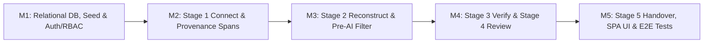

# BATON — Implementation Plan (`IMPLEMENTATION_PLAN.md`)

## 1. Guiding Principles & Execution Strategy

1. **Smallest Reliable End-to-End Implementation:** Deliver one cohesive workflow (**Connect → Reconstruct → Verify → Review → Handover**) backed by a real relational database (`SQLite`), deterministic server-side RBAC, pre-AI access filtering, exact source span provenance, and immutable versioning/audit logs.
2. **Zero External Daemon Lock-In:** Use a self-contained backend server (`server/`) and relational SQLite database (`data/baton.db`) with synthetic demo research data seeded automatically so every feature works offline or with an optional `GEMINI_API_KEY`.
3. **Strict Stage Gate Compliance:** Do not write application code during Stage 01; execute the milestones below only when instructed by the corresponding build stage prompts.

---

## 2. Milestones, Dependencies, Acceptance Criteria & Likely Files Changed

### Milestone M1 — Relational Database Schema, Synthetic Demo Seed & Core Server Bootstrap
- **Dependencies:** Approved Stage 01 Architecture (`SYSTEM_ARCHITECTURE.md`, `DATA_MODEL.md`, `API_PLAN.md`, `ROLE_PERMISSION_MATRIX.md`).
- **Scope:**
  - Initialize project package configuration and SQLite relational database module with `PRAGMA foreign_keys = ON`.
  - Create all 12 relational tables (`roles`, `users`, `projects`, `memberships`, `sources`, `source_spans`, `extracted_records`, `evidence_links`, `reviews`, `record_versions`, `handover_packages`, `handover_items`, `audit_events`).
  - Seed synthetic permissioned research data for a demo lab project (*"Solid-State Li-Garnet Electrolyte Interface Continuity"*):
    - 5 demo users covering all 5 roles (`PI_LEAD`, `RESEARCHER`, `REVIEWER`, `INCOMING_MEMBER`, `AUDITOR`).
    - 4 synthetic sources: 1 PDF report (with `[PAGE 1]`, `[PAGE 2]` spans), 1 Markdown lab notebook (with section headings & line ranges), 1 CSV experimental dataset (with row indices & sample IDs), and 1 `RESTRICTED_PI_ONLY` patent-pending note (to test restricted filtering).
  - Implement deterministic Authentication & RBAC middleware (`server/middleware/authRbac.js`) and transactional Audit Event service (`server/services/auditService.js`).
- **Likely Files Created/Changed:**
  - `package.json`
  - `.env.example`, `.gitignore`
  - `server/db/schema.sql`
  - `server/db/database.js`
  - `server/db/seed.js`
  - `server/middleware/authRbac.js`
  - `server/services/auditService.js`
  - `server/index.js`
- **Acceptance Criteria:**
  - Database initializes cleanly with all 12 relational tables and foreign key constraints active.
  - Unauthenticated requests receive `401`; unauthorized role actions receive `403` and write an `ACCESS_DENIED` row to `audit_events`.

---

### Milestone M2 — Stage 1 (Connect): Source Ingestion & Exact Provenance Span Indexing
- **Dependencies:** Milestone M1.
- **Scope:**
  - Implement `server/services/spanIndexer.js` to deterministically parse uploaded sources into `source_spans`:
    - `PDF_DOCUMENT` → `locator_type = 'PDF_PAGE'`, recording `page_number`, `char_start`, `char_end`.
    - `LAB_NOTE` → `locator_type = 'NOTE_SECTION_LINE'`, recording `section_heading`, `line_start`, `line_end`.
    - `CSV_DATASET` / `JSON_RECORDS` → `locator_type = 'CSV_ROW'` / `'JSON_RECORD'`, recording `row_index`, `record_key`, `column_names_json`.
  - Implement `/api/projects`, `/api/projects/:id/memberships`, `/api/projects/:id/sources`, and `/api/projects/:id/sources/:sourceId/spans`.
  - Enforce `RESTRICTED_PI_ONLY` SQL filtering so non-PI roles never receive restricted sources or spans.
- **Likely Files Created/Changed:**
  - `server/services/spanIndexer.js`
  - `server/routes/projects.js`
  - `server/routes/sources.js`
- **Acceptance Criteria:**
  - Uploading a PDF text, Markdown lab note, or CSV/JSON file creates `sources` and granular `source_spans` with exact page, section/line, or row/record provenance.
  - Non-PI roles querying `/sources` or `/spans` cannot view `RESTRICTED_PI_ONLY` data (`403` on direct span access; filtered out of list responses).

---

### Milestone M3 — Stage 2 (Reconstruct): Pre-AI Access Filtering, AI Proposal Adapter & Post-AI Validation
- **Dependencies:** Milestone M2.
- **Scope:**
  - Implement `server/services/preAiFilter.js` to deterministically filter out `RESTRICTED_PI_ONLY` and `exclude_from_ai = 1` sources **before** retrieval and AI prompting, logging `AI_CONTEXT_FILTERED` in `audit_events`.
  - Implement `server/services/aiReconstructor.js` with optional Gemini REST API support (`GEMINI_API_KEY`) and deterministic local structured extraction fallback over permitted spans.
  - Implement post-AI deterministic validation: verify every cited `span_id` belongs to the permitted set, verify `verbatim_quote` is an exact substring of `source_spans.content_text`, reject any numerical truth-probability percentages, initialize `approval_status = 'DRAFT'` separately from `evidence_status`, and write `record_versions` (`v1`).
- **Likely Files Created/Changed:**
  - `server/services/preAiFilter.js`
  - `server/services/aiReconstructor.js`
  - `server/routes/records.js`
- **Acceptance Criteria:**
  - Restricted spans never enter the AI prompt payload.
  - Hallucinated `span_id`s or mismatched quotes are caught deterministically.
  - Created records persist in `extracted_records`, `evidence_links`, and `record_versions`.

---

### Milestone M4 — Stage 3 (Verify) & Stage 4 (Review): Provenance Verification, Independent Governance & Versioning
- **Dependencies:** Milestone M3.
- **Scope:**
  - Implement `POST /api/projects/:id/records/:recordId/verify` allowing `PI_LEAD`, `RESEARCHER`, and `REVIEWER` to run deterministic quote/span checks, update `evidence_links`, and set categorical `evidence_status` (`UNVERIFIED`, `WEAK`, `PARTIAL`, `SUPPORTED`, `CONTRADICTED`, `BROKEN_PROVENANCE`).
  - Implement `POST /api/projects/:id/records/:recordId/reviews` allowing `PI_LEAD` and `REVIEWER` to record `APPROVE`, `REQUEST_CHANGES`, `FLAG_GAP`, or `REJECT` decisions.
  - Enforce the strict invariant: **review approval updates `approval_status` only and never upgrades or modifies `evidence_status`**.
  - Record immutable snapshots in `record_versions` on every edit, verification, and review.
- **Likely Files Created/Changed:**
  - `server/services/verificationService.js`
  - `server/services/reviewService.js`
  - `server/routes/records.js`
- **Acceptance Criteria:**
  - Approving a record with `evidence_status = 'WEAK'` results in `approval_status = 'APPROVED'` and `evidence_status = 'WEAK'`.
  - Attempting to submit a percentage confidence score returns `422 INVALID_EVIDENCE_STATUS`.
  - Full version history (`record_versions`) and review trail (`reviews`) are persisted and queryable.

---

### Milestone M5 — Stage 5 (Handover), Frontend SPA & End-to-End Automated Verification
- **Dependencies:** Milestone M4.
- **Scope:**
  - Implement `server/services/handoverService.js` and `server/routes/handovers.js` to create draft handover packages from approved, non-restricted records, allow `PI_LEAD` to publish (`PUBLISHED`), and allow `INCOMING_MEMBER` to check off item provenance and formally acknowledge (`ACKNOWLEDGED`).
  - Build the complete 5-stage Frontend SPA (`public/index.html`, `public/styles.css`, `public/app.js`) with:
    - Role/Persona switcher bar (to test `PI_LEAD`, `RESEARCHER`, `REVIEWER`, `INCOMING_MEMBER`, `AUDITOR` permissions live).
    - Stage 1 Connect view (source upload, visibility badge, expandable provenance span viewer).
    - Stage 2 Reconstruct view (pre-AI filter banner showing excluded restricted sources, candidate extraction, manual record editor).
    - Stage 3 Verify view (side-by-side record & verbatim source span verifier, categorical evidence selector).
    - Stage 4 Review view (reviewer decision form, explicit separation of Evidence Status badge and Approval Status badge, version timeline).
    - Stage 5 Handover view (package builder, PI publish button, incoming researcher provenance checklist & formal acknowledgement sign-off).
    - Audit Log drawer (visible to `PI_LEAD` and `AUDITOR`).
  - Write automated integration tests (`tests/workflow.test.js`) covering the complete 5-stage workflow, RBAC denials, restricted data filtering before AI/handover, and the evidence-vs-approval separation invariant.
- **Likely Files Created/Changed:**
  - `server/services/handoverService.js`
  - `server/routes/handovers.js`
  - `public/index.html`
  - `public/styles.css`
  - `public/app.js`
  - `tests/workflow.test.js`
  - `README.md`
- **Acceptance Criteria:**
  - Complete workflow **Connect → Reconstruct → Verify → Review → Handover** executes end-to-end with real SQLite persistence and zero mock/fake UI buttons.
  - Automated integration suite passes all RBAC, provenance, pre-AI filter, evidence-approval independence, and handover acknowledgement assertions.

---

## 3. Milestone Dependency Graph

