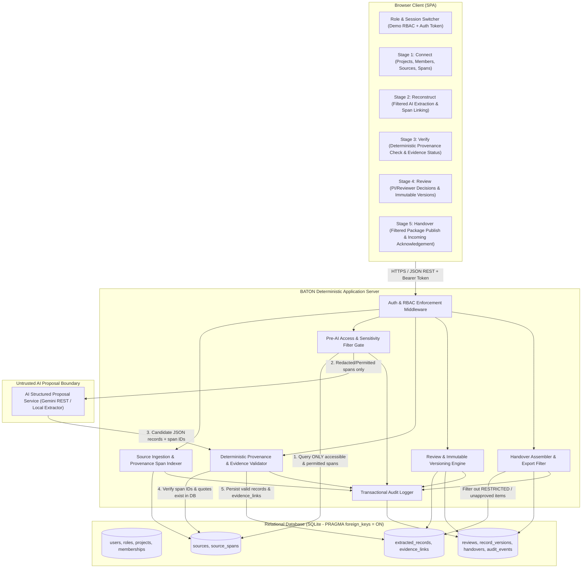
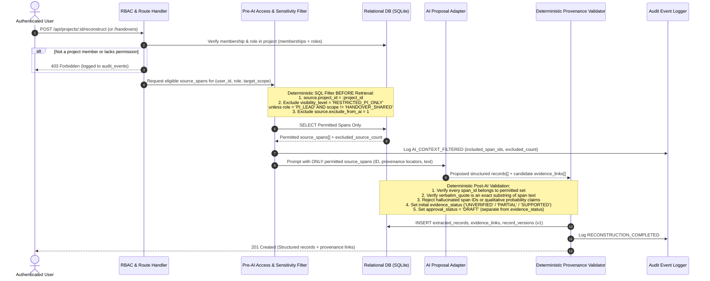

# BATON — System Architecture (`SYSTEM_ARCHITECTURE.md`)

## 1. Baseline & Stack Selection

Per [AUDIT_REPORT.md](file:///c:/Users/Pournima/Desktop/codefronteir/AUDIT_REPORT.md), the repository at `C:\Users\Pournima\Desktop\codefronteir` started with no existing application code (`0` source files). To deliver the smallest, most reliable end-to-end implementation of the BATON five-stage workflow (**Connect → Reconstruct → Verify → Review → Handover**) without unnecessary framework complexity or fragile build chains:

| Layer | Technology Choice | Rationale |
| :--- | :--- | :--- |
| **Frontend UI** | Single-Page Application (Semantic HTML5, CSS3, Modular Vanilla ES6 JS) served statically by the backend | Zero bundler fragility, deterministic state synchronization with backend APIs, direct side-by-side provenance inspection across all 5 stages. |
| **Backend API** | Node.js HTTP/REST JSON Server (`node:http` / Express-compatible routing) | Single-command startup, deterministic middleware pipeline for RBAC, pre-AI access filtering, provenance span validation, versioning, and audit logging. |
| **Relational Database** | SQLite (`node:sqlite` / `sqlite3` relational engine with `PRAGMA foreign_keys = ON`) | Zero external daemon required for local evaluation while providing strict relational integrity, foreign keys, ACID transactions, and SQL filtering across all 12 required entity tables. |
| **AI Proposal Layer** | Pluggable Structured Proposal Adapter (`Gemini API` via REST `fetch` + deterministic local structured parser fallback) | Strictly isolated behind a deterministic pre-filter and post-validation gate. Runs offline/locally with synthetic demo data when no API key is configured, or uses Gemini when `GEMINI_API_KEY` is provided. |

---

## 2. Component Architecture Diagram

---

## 3. Data-Flow & Pre-AI Restricted Data Filtering Diagram

A core architectural invariant of BATON is that **inaccessible or restricted data is filtered by deterministic SQL queries and application guards BEFORE retrieval, model prompting, summarisation, and handover generation**. The AI model never receives restricted spans in its context window.

---

## 4. Deterministic Application vs. AI Boundary

| Responsibility | Owner | Enforcement Mechanism |
| :--- | :--- | :--- |
| **Authentication & Role Authorization** | Deterministic Code | Server-side session/token verification against `users`, `memberships`, and `roles` tables on every endpoint. |
| **Restricted Data Filtering** | Deterministic Code | SQL `WHERE` predicate in `preAiFilter.js` strips `RESTRICTED_PI_ONLY` and `exclude_from_ai = 1` sources **before** spans are loaded into memory for AI prompting, summarisation, or handover generation. |
| **Candidate Record Extraction & Summarisation** | AI Proposal Layer | Proposes candidate `record_type`, `title`, `statement`, and references to `span_id`s from the pre-filtered context. Cannot write directly to the database. |
| **Provenance Reference Validation** | Deterministic Code | Checks that each cited `span_id` exists in the permitted span set for the project, verifies the locator (`page_number`, `section_heading`/`line_start`, or `row_index`/`record_key`), and checks that `verbatim_quote` matches the source span text. |
| **Evidence Status Classification** | Deterministic Code + Verifier | Categorical enum only (`UNVERIFIED`, `WEAK`, `PARTIAL`, `SUPPORTED`, `CONTRADICTED`, `BROKEN_PROVENANCE`). **Truth-probability percentages (e.g., "87% true") are strictly prohibited and rejected by validation.** |
| **Human Approval & Review** | Deterministic Code + Reviewer Role | Stored in `extracted_records.approval_status` (`DRAFT`, `PENDING_REVIEW`, `APPROVED`, `NEEDS_REVISION`, `REJECTED`) and `reviews`. **Modifying `approval_status` never mutates `evidence_status`.** |
| **Record Versioning** | Deterministic Code | Every create, edit, verification update, or review decision writes an immutable snapshot row in `record_versions`. |
| **Audit Trail** | Deterministic Code | Every state-changing operation and access denial writes an append-only row in `audit_events` within the same database transaction. |

---

## 5. End-to-End Five-Stage Workflow Architecture

1. **Stage 1 — Connect (`/connect`):**
   - Select or create a research project, inspect project memberships/roles, upload or load synthetic permissioned research sources (`PDF_DOCUMENT`, `LAB_NOTE`, `CSV_DATASET`, `JSON_RECORDS`), set source visibility (`PROJECT_SHARED` vs. `RESTRICTED_PI_ONLY`) and AI-eligibility (`exclude_from_ai`), and automatically index granular `source_spans` with exact provenance locators (PDF page number, Markdown note section & line range, CSV/JSON row index & record key).
2. **Stage 2 — Reconstruct (`/reconstruct`):**
   - Trigger structured reconstruction over selected project sources. The server runs the Pre-AI Filter Gate, records how many restricted sources/spans were excluded, prompts the AI proposal adapter (or deterministic extractor), validates all returned span citations, and creates `extracted_records` (`CLAIM`, `METHOD`, `PROTOCOL`, `DATASET_FINDING`, `OPEN_QUESTION`, `RISK_LIMITATION`), `evidence_links`, and initial `record_versions`.
3. **Stage 3 — Verify (`/verify`):**
   - Run deterministic provenance integrity checks (verifying span existence, quote match, and multi-source corroboration) and allow authorized researchers (`PI_LEAD`, `RESEARCHER`, `REVIEWER`) to inspect exact source spans side-by-side, add/remove `evidence_links`, and set the categorical `evidence_status` (`UNVERIFIED`, `WEAK`, `PARTIAL`, `SUPPORTED`, `CONTRADICTED`, `BROKEN_PROVENANCE`) with verification notes.
4. **Stage 4 — Review (`/review`):**
   - Formal review queue for `PI_LEAD` and `REVIEWER`. Reviewers examine each record's `evidence_status` alongside its exact provenance spans and submit a review decision (`APPROVE`, `REQUEST_CHANGES`, `FLAG_GAP`, `REJECT`). Approval updates `approval_status` (e.g., to `APPROVED`) and creates a new `record_versions` snapshot **without altering `evidence_status`** (e.g., an approved record documenting a known preliminary observation with `WEAK` evidence remains `evidence_status = 'WEAK'` and displays a clear warning badge).
5. **Stage 5 — Handover (`/handover`):**
   - Assemble a versioned Handover Package for an incoming team member (`INCOMING_MEMBER`). Deterministic filtering excludes any `RESTRICTED_PI_ONLY` sources/spans from the handover summary and package items. A `PI_LEAD` publishes the package (`PUBLISHED`), and the assigned `INCOMING_MEMBER` inspects each handover item, clicks through to its exact source provenance, and submits a formal **Acknowledgement** (`ACKNOWLEDGED`) recorded in `handovers` and `audit_events`.
